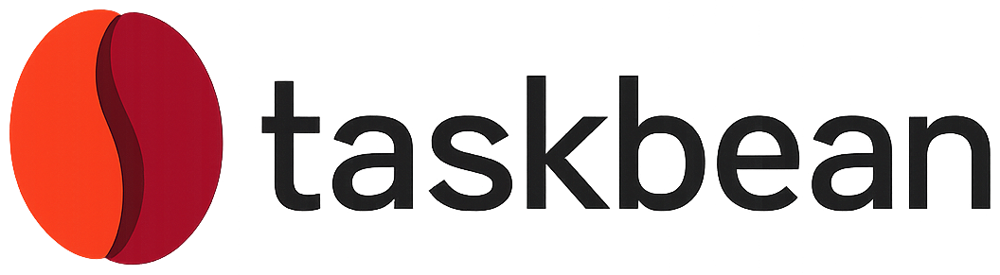
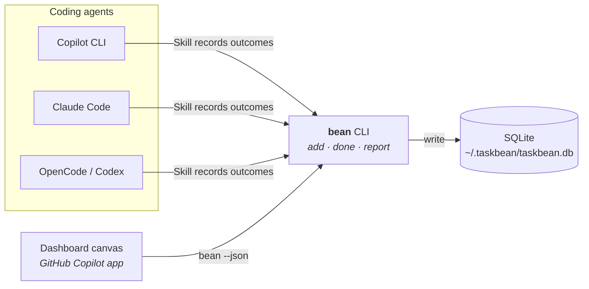

<div align="center">

<picture>
  <source media="(prefers-color-scheme: dark)" srcset="app/public/icons/taskbean-wordmark-light.png" />
  <source media="(prefers-color-scheme: light)" srcset="app/public/icons/taskbean-wordmark.png" />
  
</picture>

<br /><br />
**No cloud. No subscription. No data leaves your machine.**

[](https://taskbean.ai)
[](LICENSE)
[](https://www.microsoft.com/windows)
[](docs/copilot-plugin.md)

</div>

---

## What is taskbean?

A local-first task ledger for developers whose day job involves a coding agent, packaged as a GitHub Copilot plugin. Three parts, one SQLite file:

| | CLI (`cli/`) | Agent Skill (`.agents/skills/taskbean`) | Dashboard canvas (`extensions/taskbean-dashboard`) |
|---|---|---|---|
| **For** | Agents and scripts | The agent | You, inside the GitHub Copilot app |
| **Does** | Stores outcomes and evidence, builds reports | Tells the agent when to record one outcome, correct it, or report | Board, quick add, start/block/complete, session/PR links, observe-only evidence, weekly report |
| **Tech** | Node.js, commander, SQLite | Agent Skills spec | Copilot SDK canvas, loopback UI |

All parts read and write `~/.taskbean/taskbean.db`. The agent does the typing; you do the reviewing. Nothing leaves the machine.



## Quick start

### GitHub Copilot plugin

Taskbean 0.7 brings the Agent Skill and Dashboard canvas into one Copilot plugin.
The CLI remains an explicit prerequisite.
See [installation, compatibility and migration](docs/copilot-plugin.md).

### CLI (agent skill)

```bash
# Install globally
npm install -g taskbean

# Or via platform binary (checksum-verified against SHA256SUMS on the release)
curl -fsSL https://taskbean.ai/install | bash          # macOS / Linux (x64 + arm64)
iwr -useb https://taskbean.ai/install.ps1 | iex        # Windows PowerShell

# Or via winget (Windows)
winget install taskbean.taskbean

# Use it
bean add "fix auth bug before standup"
bean done 1
bean list
bean report
bean chronicle doctor --json  # diagnose local Copilot session data availability
bean chronicle reconcile --since 2026-04-20 --until 2026-04-26 --json
```

### Updating taskbean

```bash
bean upgrade              # channel-aware: re-runs npm i -g or re-downloads the binary
bean upgrade --check      # print latest vs. current, exit without touching anything
bean upgrade --json       # machine-readable
```

`bean` prints a one-line notice on stderr (at most once every 24 hours) when a new release is available. It stays silent in CI, non-TTY, and when `TASKBEAN_NO_UPGRADE_NOTICE=1` is set. Cached at `~/.taskbean/.upgrade-check.json`.

Pick **one** install channel and stick with it. If you install via both `npm` and the platform binary, you end up with two `bean`s on `PATH` and `bean upgrade` only refreshes the one it was launched from. The install scripts write `~/.taskbean/.install-channel` so `bean upgrade` knows which path to take.

**Recovering from a double install.** `which bean` (POSIX) / `where bean` (Windows) lists every `bean` on `PATH` when you have more than one. Remove whichever you don't want — `npm uninstall -g taskbean` for the npm path, or `rm "$(command -v bean)"` for the standalone binary — then re-run `bean upgrade` to bring the remaining one up to date.

## Project structure

```
taskbean/
├── cli/                    # Agent-facing CLI tool
│   ├── bin/taskbean.js     # Entry point (aliased as `bean`)
│   ├── src/commands/       # CLI commands: add, done, list, report, chronicle...
│   ├── src/data/           # SQLite store, date parsing, project detection
│   ├── pwa/                # Minimal dashboard for `bean serve`
│   ├── scripts/            # Install scripts (curl|bash, PowerShell)
│   ├── evals/              # Agent skill evaluation scenarios
│   └── package.json        # npm: "taskbean"
│
├── extensions/taskbean-dashboard/  # Copilot dashboard canvas (plugin)
├── plugin.json             # Copilot plugin manifest
├── app/                    # Legacy desktop PWA (not part of the plugin)
│   ├── agent/              # Python backend (FastAPI + Foundry Local)
│   ├── public/             # Single-file vanilla JS PWA
│   ├── tests/              # Playwright test suite (21 specs)
│   ├── server.js           # Node.js backend (Express, legacy)
│   ├── db.js               # SQLite schema + CRUD
│   └── package.json        # "taskbean-app" (not published to npm)
│
├── .agents/skills/taskbean/SKILL.md   # Agent skill manifest
├── .github/
│   ├── copilot-instructions.md
│   └── workflows/release.yml
├── LICENSE
└── README.md               # ← you are here
```

## Works with

taskbean ships as an [Agent Skill](https://agentskills.io). Drop it in the right folder and the agent picks it up on its next run. `bean install` handles the folder.

```bash
bean install              # .agents/skills/  (Copilot CLI, OpenCode, Codex)
bean install --agent auto # detect installed agent CLIs on PATH and install into each
bean install --global     # same, but in ~/  so every project sees it
bean install --agent claude                  # .claude/skills/  (Claude Code needs its own folder)
bean install --agent codex --codex-sandbox   # also whitelists ~/.taskbean in ~/.codex/config.toml
bean install --agent all                     # install everywhere
```

| Agent | Skill Discovery | Status | Notes |
|-------|----------------|--------|-------|
| **GitHub Copilot CLI** | `.agents/skills/` | ✅ Verified | Full E2E: discovers skill, calls `bean add`/`bean done` |
| **OpenCode** | `.agents/skills/` | ✅ Verified | Full E2E: discovers skill, calls `bean add`/`bean done` |
| **OpenAI Codex** | `.agents/skills/` | ✅ Verified | Full E2E: discovers skill, calls `bean add`/`bean done`. Codex's sandbox may block direct edits to project source; use `bean install --agent codex --codex-sandbox` to also whitelist `~/.taskbean` in `~/.codex/config.toml` |
| **Claude Code** | `.claude/skills/` | ✅ Verified | Needs `.claude/skills/` (does not scan `.agents/skills/`). `bean install` handles this |
| **Any Agent Skills-compatible agent** | `.agents/skills/` | ✅ Expected | Follows the [Agent Skills spec](https://agentskills.io) |

## How it works

### The CLI is the robot

Run `bean --help` for the grouped command list (outcomes, evidence and review, reports, projects, maintenance, legacy). The skill records one outcome per meaningful result, with `bean add --key` and `bean done` or `bean block`. Commands, retries, branches and sub-steps are evidence, not separate tasks. Planner and To Do own commitments, owners and dates; Copilot sessions and plan mode are execution evidence. Manual `bean edit`/`bean done` calls are corrections. Turn hooks (#115) are not shipped yet.

### The dashboard is the human side

The Taskbean Dashboard canvas runs inside the GitHub Copilot app. It reads the ledger through `bean --json`, groups work by workspace, and lets you add, start, block and complete tasks or generate a weekly report without leaving the session. **Resume** and **Review blocker** open the linked Copilot session, and **Open PR** opens the pull request, after a click; they never send a message or change a task. **Collect evidence (observe only)** gathers pending suggestions from local session metadata and shows them as not accepted outcomes. See [installation](docs/copilot-plugin.md).

> The older desktop PWA in `app/` (FastAPI, Foundry Local) is no longer part of Taskbean's direction. Its code stays in the repository but it is not shipped, tested or supported by the plugin.

### Chronicle/session diagnostics

`bean chronicle doctor --json` checks whether local GitHub Copilot Chronicle/session data is discoverable without importing raw prompts, responses, or tool outputs into taskbean. It reports local `~/.copilot/session-state/` and `~/.copilot/session-store.db` availability, expected metadata tables, privacy defaults, and known limitations such as unavailable programmatic `/chronicle` API or unknown remote-sync policy state.

### Chronicle-backed weekly reviews

Taskbean treats its own task ledger as canonical. Chronicle/session data is evidence that can help find work the agent forgot to log, not a second source of truth. Run reconciliation to create review-only suggestions, approve or link only the ones that are real, then build the weekly report.

Daily reconciliation:

```bash
bean chronicle reconcile --since 2026-04-20 --until 2026-04-20 --json
bean chronicle suggestions --status pending --json
```

Observe-only collection:

```bash
bean chronicle reconcile --observe --json             # resume from the last checkpoint
bean chronicle reconcile --observe --limit 50 --json  # bound one run
```

`--observe` never auto-links, creates, completes or edits tasks. It writes only pending suggestions, unlinked evidence and a checkpoint, so a replay or a run after a crash creates no duplicates. It skips the current agent session (and any `--exclude-session` ids) so its own runs do not become evidence.

Each pending suggestion includes a stable `id`, `suggested_title`, `evidence_summary`, `confidence`, source session ids, `occurred_at` work time, and privacy-safe evidence metadata such as branch, refs, and changed file paths. Exact session matches to existing Taskbean tasks are auto-linked as evidence and suppressed from the pending inbox; fuzzy matches still stay pending for human review. A suggestion is not a task until you explicitly approve it or link it:

```bash
bean chronicle approve <suggestion-id> --status done --tags weekly-review --json
bean chronicle approve <suggestion-id> --work-date 2026-04-20 --json
bean chronicle link <suggestion-id> <todo-id> --json
bean chronicle ignore <suggestion-id> --json
```

Weekly report modes:

```bash
bean report --date week --json                      # canonical Taskbean tasks only
bean report --date week --include-chronicle --json  # tasks plus linked evidence and needs-review suggestions
bean report --date week --include-chronicle         # Markdown draft for copying
```

Automation should consume JSON and inspect fields like `counts.pending`, `counts.linked`, `suggestions`, `taskGroups`, `chronicle.summary`, and `chronicle.pendingSuggestions`; do not scrape Markdown output. Pending suggestions and linked evidence are filtered by work time (`occurred_at`), not by the date reconciliation or approval happened. Approving a suggestion defaults the created task's date to the evidence work time; use `--work-date` or the dashboard work-date field when you need to correct it. A simple local cadence is: run `chronicle reconcile --json` daily, review the pending inbox in the dashboard or with `chronicle suggestions --json`, and run the evidence-enriched weekly report before a 1-on-1 or status update. For monthly improvement reviews, keep the weekly JSON reports as artifacts or use `--date all` and filter the JSON downstream.

Privacy and availability:

- Taskbean stores task metadata, evidence summaries, confidence scores, source session ids, branch names, refs, and file paths. It does not copy raw prompts, assistant responses, tool outputs, or command output into `~/.taskbean/taskbean.db` by default.
- Chronicle/session evidence is local-machine evidence. If local Copilot session files are missing, enterprise policy blocks access, the user opts out, or the work happened only in a cloud agent with no local sync, reconciliation returns an unavailable/zero-suggestion JSON result and reports continue from canonical Taskbean tasks.
- Business/Enterprise retention and sync behavior is controlled outside Taskbean. Use `bean chronicle doctor --json` to see what this machine can access, and treat unknown remote-sync state as a limitation rather than proof that no work happened.
- Privacy hardening follow-up: when Chronicle schemas evolve, keep reconciliation's metadata/summary allowlist and doctor diagnostics' raw-content denylist in sync so new fields do not weaken the metadata-only guarantee.

## Storage

Everything lives in one file:

```
~/.taskbean/taskbean.db
```

No cloud sync, no accounts, no phone-home telemetry. Delete the file, taskbean forgets.

## License

[MIT](LICENSE). Free forever.
